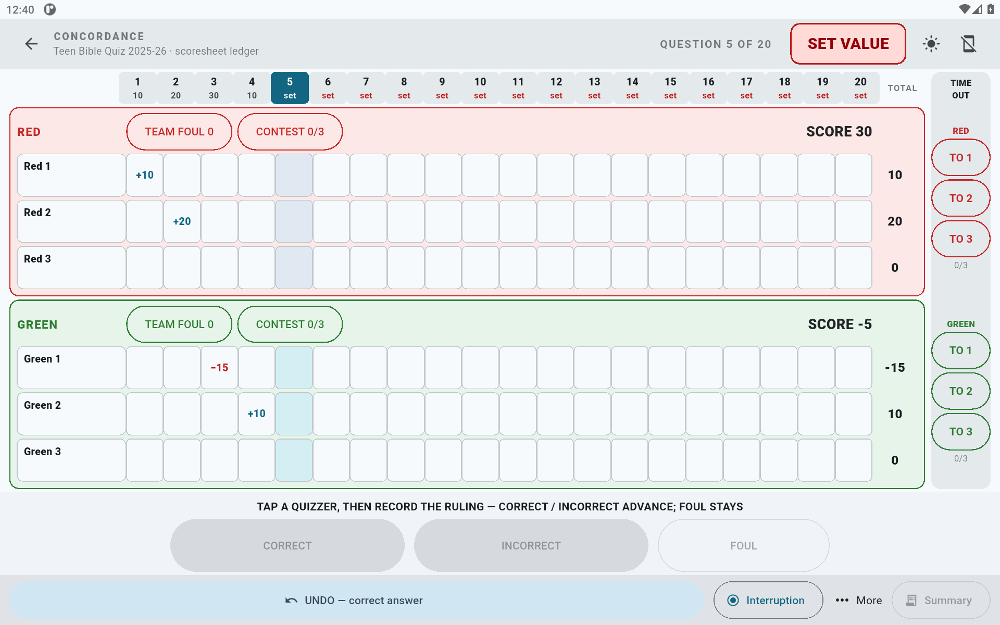

# Download Concordance

**Free, offline scorekeeping for Teen Bible Quiz and Junior Bible Quiz.**

No account, no internet needed, and completely free.

[Download for Amazon Fire or Android](https://github.com/JosiahL06/Concordance/releases/latest/download/app-release.apk){ .md-button .md-button--primary }
[Using a computer?](#windows-mac-or-linux){ .md-button }

!!! tip "Reading this on the tablet you will use?"
    Tap the blue button above. The file downloads to your tablet. When it
    finishes, open your **Downloads** list and tap the file.

## Choose your device

### Amazon Fire tablet — recommended

Concordance is built and tested around the **Amazon Fire HD 10**. It works
without Google Play, and you do not need an Amazon account to keep score.

[Download for Fire](https://github.com/JosiahL06/Concordance/releases/latest/download/app-release.apk){ .md-button .md-button--primary }
[Fire installation guide](installation/fire-hd-10.md)

**After downloading:** open **Downloads**, tap the file, allow your tablet to
install it, then tap **Open**.

### Android tablet or phone

Works on most Android tablets and phones. Use the same download as the Fire
tablet.

[Download for Android](https://github.com/JosiahL06/Concordance/releases/latest/download/app-release.apk){ .md-button .md-button--primary }
[Android installation guide](installation/android.md)

**After downloading:** open your **Downloads** or notification, tap the file,
and allow installation when Android asks.

### Windows, Mac, or Linux

These versions are folders or apps rather than app-store installs. The step-by-
step guides explain the one-time warning your computer may show.

#### Windows

[Download for Windows](https://github.com/JosiahL06/Concordance/releases/latest/download/concordance-windows-x64.zip){ .md-button .md-button--primary }
[Windows installation guide](installation/windows.md)

#### Mac

[Download for Mac](https://github.com/JosiahL06/Concordance/releases/latest/download/concordance-macos.zip){ .md-button .md-button--primary }
[Mac installation guide](installation/macos.md)

#### Linux

[Download for Linux](https://github.com/JosiahL06/Concordance/releases/latest/download/concordance-linux-x64.tar.gz){ .md-button .md-button--primary }
[Linux installation guide](installation/linux.md)

## The first time you open it

You may see a warning because Concordance is a new, independent app and is not
sold through the app stores.

- **Fire or Android:** if your tablet says it cannot install apps from this
  source, open **Settings**, allow your browser or **Files** app to install
  apps, then try again.
- **Windows:** if you see **“Windows protected your PC”**, click **More info**,
  then **Run anyway**.
- **Mac:** if macOS will not open the app, right-click it, choose **Open**, then
  click **Open** again.
- **Linux:** follow the [Linux guide](installation/linux.md) for the few
  terminal commands.

These warnings are normal for a free app distributed outside an app store.
They do not mean anything is wrong with the download or your device.

## Need help?

- [Fire tablet guide](installation/fire-hd-10.md)
- [Android guide](installation/android.md)
- [Windows guide](installation/windows.md)
- [Mac guide](installation/macos.md)
- [Linux guide](installation/linux.md)
- [Troubleshooting & FAQ](troubleshooting/index.md)
- [Updating & uninstalling](installation/updating-and-uninstalling.md)

## Stay up to date

The buttons above always download the newest release. See
[what's new](https://github.com/JosiahL06/Concordance/releases/latest) or read
the [changelog](CHANGELOG.md).

---

Concordance is an independent community project. It is not affiliated with or
endorsed by Bible Quiz or its organizing bodies. [See the source code here](https://github.com/JosiahL06/Concordance).
