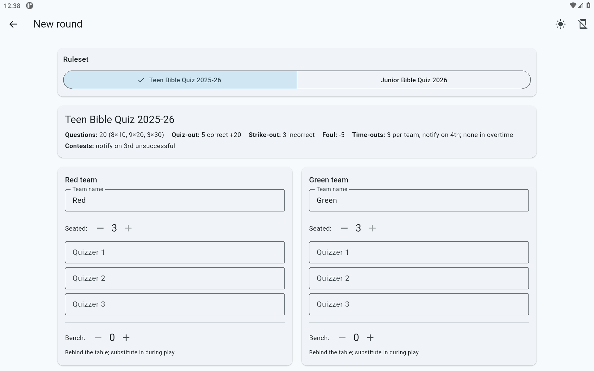
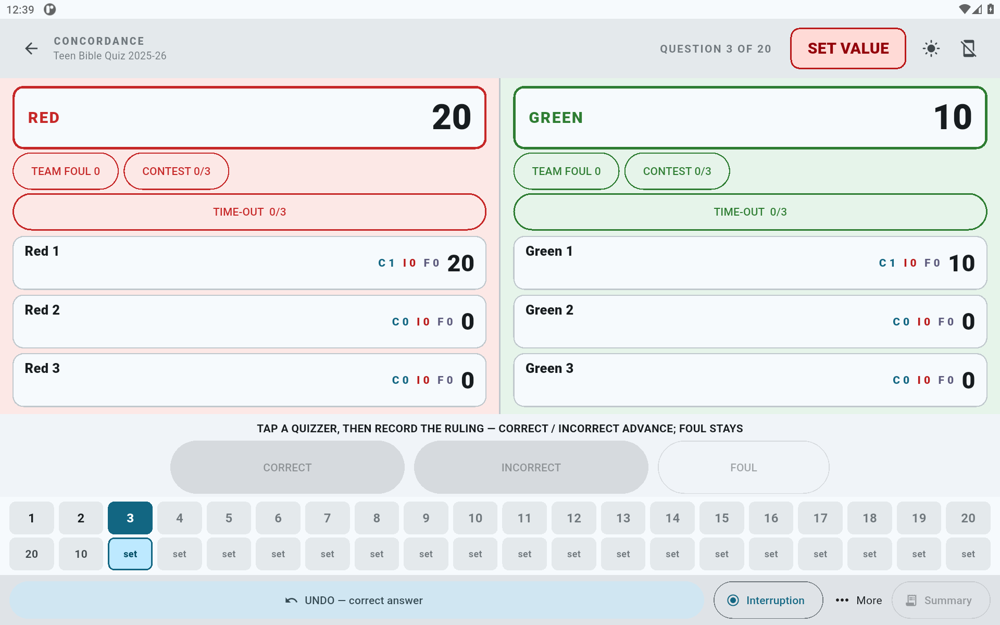
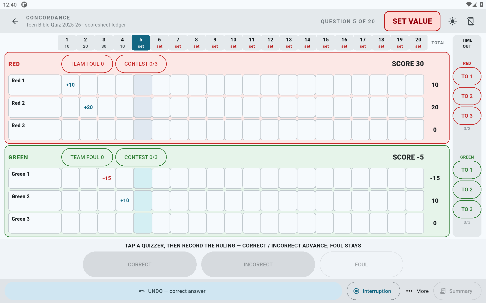
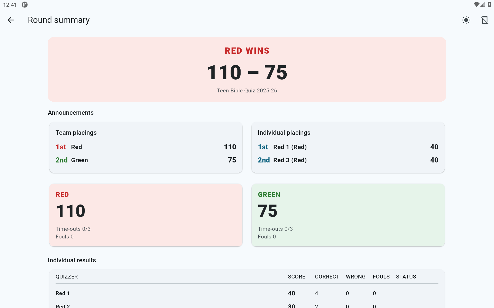

# Concordance

**A clean, modern scorekeeping app for Bible Quiz matches**, built to be
intuitive and usable within seconds of picking it up.

!!! warning "Not for official use"
    Concordance is an independent community project, **not affiliated with or
    endorsed by Bible Quiz** or its organizing bodies, and it is **not the
    scorekeeper of record** for official matches. Personal, practice, and
    unofficial use is welcome.

## What this app is

A Bible Quiz match has two teams of quizzers seated at a quiz box. The
quizmaster reads questions that are worth different numbers of points, and
quizzers buzz in to answer. Correct answers add points, incorrect answers take
points away, and a quizzer can reach the end of their turn by quizzing out,
striking out, or fouling out. Somebody has to keep all of that straight, live
and fast.

Concordance does that job. It is an app for keeping score through a single
round of a match. It is made for the scorekeeper sitting beside the quiz box —
most often a volunteer who has just been handed a tablet and needs to be
scoring within a minute.

## What makes it different

- **One tap does the work.** Every scoring action is a single large button,
  with nothing hidden behind a long press or a swipe.
- **Undo is always there.** If you tap the wrong thing, one tap takes it back.
- **Every mark on the paper scoresheet is captured** — interruptions,
  contests, time-outs, and fouls each have their own simple control.
- **It never makes a sound.** No beeps, no clicks, no music — nothing to
  distract a match.
- **It keeps working with no internet**, and it saves every entry the moment
  you make it. A dead battery or a crash mid-match never loses the round.

## See it

| Setup | Live scoring — Modern | Live scoring — Classic | Summary |
| :-: | :-: | :-: | :-: |
|  |  |  |  |

## What it works with

- **Rules**: the Teen Bible Quiz and Junior Bible Quiz rulesets are both built
  in, so the same app scores either program. See
  [Rulesets](rulesets/index.md) for the details.
- **Devices**: an Amazon Fire tablet is recommended. Android tablets and
  phones, Windows, Linux, and Mac are also supported. Downloads are on the
  project's [Releases page](https://github.com/JosiahL06/Concordance/releases).

## Start here

- [Your first match](getting-started/first-match.md) — score a short practice
  round from start to finish.
- [Which download do I need?](installation/index.md) — pick the right file for
  your device.
- [Troubleshooting & FAQ](troubleshooting/index.md) — answers to common
  questions.
